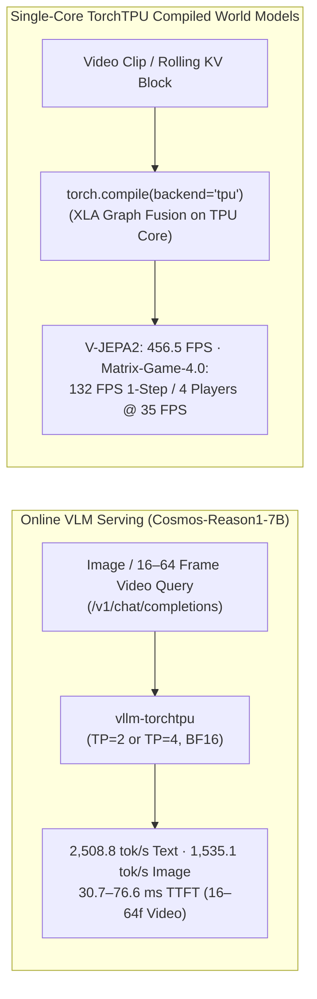

# World Simulation & Physical Reasoning on Google Cloud TPUs (TorchTPU)

PyTorch (`torch_tpu`) benchmarks for world-simulation and physical-reasoning models on **Google Cloud TPU v7x** and **TPU v5p**. On a single TPU v7x TensorCore with `torch.compile(backend="tpu")`, 5B **Skywork/Matrix-Game-4.0** sustains **`132.0 FPS`** (1-step, 8,000 RGB frames), **`99.4 FPS`** (2-step), and **`66.2 FPS`** (4-step) at full `KV=21` (`864×480`) with **`<0.85 ms` `p99–p50` jitter**, and serves **4 concurrent interactive players on 1 core at `35.2 FPS` each** (`140.6 FPS` aggregate). Meanwhile, 1B **V-JEPA2-ViT-g** reaches **`456.5 FPS`**, and **Cosmos-Reason1-7B** on `vllm-torchtpu` reaches **`2,508.8 tok/s`** text (`TP=2`, 1 chip), **`1,535.1 tok/s`** image multimodal (`TP=4`), and **`30.7–76.6 ms` `c=1` TTFT** on **`16`–`64` frame long-context robotics videos** (`2,377–9,385` prompt tokens).

---

## Models & Licenses

This repository tracks world-simulation and physical-reasoning model benchmarks on Google Cloud TPUs. Each model's folder contains detailed tables and reproduction commands.

| Model | Params & Precision | Role & Architecture | License | Folder |
| :--- | :---: | :--- | :---: | :--- |
| [`nvidia/Cosmos-Reason1-7B`](https://huggingface.co/nvidia/Cosmos-Reason1-7B) | 7B (`bf16`) | Physical-AI multimodal VLM (Qwen2.5-VL backbone, `16K–32K` ctx) | NVIDIA Open Model | [`cosmos-reason1-7b/`](cosmos-reason1-7b/README.md) |
| [`facebook/vjepa2-vitg-fpc64-256`](https://huggingface.co/facebook/vjepa2-vitg-fpc64-256) | 1.0B (`bf16`) | Self-supervised ViT-giant world-model video encoder (`256×256`) | MIT | [`vjepa2-vitg/`](vjepa2-vitg/README.md) |
| [`Skywork/Matrix-Game-4.0`](https://huggingface.co/Skywork/Matrix-Game-4.0) | 5.0B (`bf16`) | Causal autoregressive streaming world simulator (`864×480`, `CausalWanModel`) | Apache-2.0 | [`matrix-game/`](matrix-game/README.md) |
| [`nvidia/Cosmos3-Super`](https://huggingface.co/nvidia/Cosmos3-Super) | 27 shards (`bf16`) | Generative physical-world video foundation model | NVIDIA Open Model | [`cosmos3-super/`](cosmos3-super/README.md) |

---

## Hardware & Software Stack

| Component | Configuration |
| :--- | :--- |
| **TPU v7x** | 1 TensorCore (`V-JEPA2`, `Matrix-Game-4.0`); 1–2 chips (`TP=2` / `TP=4` for `Cosmos-Reason1-7B`), 96 GB HBM/core |
| **TPU v5p** | 1 chip (`V-JEPA2`, `Matrix-Game-4.0`); 4 chips (`TP=4` for `Cosmos-Reason1-7B`), 95 GB HBM/chip |
| **Serving Engines** | `vllm-torchtpu v0.32.0` & `v0.33.0` + `vllm-omni 0.33.0rc1`; `sglang-torchtpu` (`main`) |
| **PyTorch Compilation** | Native `torch.compile(backend="tpu")` on `torch 2.13.0`, `torch_tpu 0.2.0`, `libtpu 0.0.50` |

---

## Architecture & Execution Paths



---

## Main Results (`finite=True` Verified on Every Run)

### 1. Physical Reasoning VLM Serving (`Cosmos-Reason1-7B`, `vllm-torchtpu`, `BF16`)

| Hardware & Topology | Engine | `text 1k/256` (`c=1` / `c=64`) | `text 8k/512` (`c=1` / `c=16`) | `mm_img 512×512` (`c=4` / `c=16`) | Comparison |
| :--- | :--- | :---: | :---: | :---: | :--- |
| **TPU v7x (1 chip, `TP=2`)** | `vllm-torchtpu v0.32.0` | **220.6** / **2,508.8 tok/s** | 228.7 / 1,119.4 tok/s | 506.9 / 1,155.2 tok/s | **1.31×** higher `c=64` throughput than 4-chip TPU v5p (`5.25×` per chip) |
| **TPU v7x (2 chips, `TP=4`)** | `vllm-torchtpu v0.32.0` | 206.4 / 2,345.6 tok/s | **272.7** / **1,294.1 tok/s** | 884.8 / **1,535.1 tok/s** (`TTFT 43.5 ms`) | **1.66×** higher multimodal throughput than 4-chip TPU v5p |
| **TPU v7x (2 chips, `TP=4`)** | `vllm-torchtpu v0.33.0` | — | **275.5** / 1,062.6 tok/s (`TPOT 3.10 ms`) | **1,010.0** (`TTFT 23.8 ms`) / 1,399.2 tok/s | **1.14×** higher `c=4` multimodal throughput vs. `v0.32.0` |
| TPU v5p (4 chips, `TP=4`) | `vllm-torchtpu v0.32.0` | 216.7 / 1,910.9 tok/s | 239.3 / 1,184.9 tok/s | 676.5 / 923.3 tok/s (`TTFT 66.6 ms`) | TPU v5p baseline |

#### Long-Context Multi-Frame Video Reasoning (`Cosmos-Reason1-7B`, `vllm-torchtpu v0.33.0`, 2 TPU v7x Chips `TP=4`, `32K` Context)

| Video Length (`336×336` Frames) | Avg Prompt Tokens | `c=1` TTFT (`p50` / `p95`) | `c=4` Throughput & `p50` TTFT | Peak Throughput |
| :--- | :---: | :---: | :---: | :---: |
| **`16` frames** | 2,377 | **30.7 ms** / 34.9 ms (`236.6 tok/s`) | 282.0 tok/s (`62.4 ms`) | **418.5 tok/s** (`c=8`, `117.7 ms` TTFT) |
| **`32` frames** | 4,713 | **45.4 ms** / 50.2 ms | **259.3 tok/s** (`121.8 ms`) | **259.3 tok/s** (`c=4`) |
| **`64` frames** | 9,385 | **76.6 ms** / 83.3 ms | **152.8 tok/s** (`490.0 ms`) | **152.8 tok/s** (`c=4`) |

### 2. Compiled World Encoders & Sustained Interactive Streaming (1 TPU Core / Chip)

| Model (Params) | Workload | TPU v7x (1 core, `tpu` compile) | TPU v5p (1 chip, `tpu` compile) | Speedup vs. Eager / Chip Scaling |
| :--- | :--- | :---: | :---: | :--- |
| **V-JEPA2-ViT-g** (1.0B) | `16f B=1` (`256×256`) | **40.00 ms** (**400.0 FPS**) | 43.47 ms (368.1 FPS) | **4.62×** (v7x) / **6.62×** (v5p) vs. eager; **1.09×** v7x vs. v5p |
| **V-JEPA2-ViT-g** (1.0B) | `16f B=32` (`256×256`) | 1,121.7 ms (**456.5 FPS**, 28.5 clips/s) | 1,214.2 ms (421.7 FPS, 26.4 clips/s) | **1.08×** higher peak FPS on v7x vs. v5p |
| **V-JEPA2-ViT-g** (1.0B) | `64f B=1` (`256×256`) | **257.09 ms** (**248.9 FPS**) | 265.77 ms (240.8 FPS) | **1.45×** (v7x) / **1.69×** (v5p) vs. eager |
| **Matrix-Game-4.0** (5.0B) | `KV=6` 1-step (`864×480`) | **15.83 ms** (**252.75 FPS**) | 24.27 ms (164.81 FPS) | **2.68×** vs. eager; **1.53×** v7x vs. v5p |
| **Matrix-Game-4.0** (5.0B) | **Full `KV=21` 1-step** | **29.92 ms** (**133.69 FPS**) | 50.72 ms (78.87 FPS) | **3.33×** vs. eager; **1.70×** v7x vs. v5p |
| **Matrix-Game-4.0** (5.0B) | **Full `KV=21` 2-step** | **58.35 ms** (**68.56 FPS**) | 100.30 ms (39.88 FPS) | **3.41×** vs. eager; **1.72×** v7x vs. v5p |

#### Sustained Streaming Stability & Multi-Player Batching (`Matrix-Game-4.0`, 1 TPU v7x Core, `864×480`, Continuous Rolling KV, `finite=True`)

| Profile (`4` RGB Frames/Block) | Continuous Blocks (RGB Frames) | Block `p50` / `p99` | `p99–p50` Jitter | **Per-Stream FPS** | **Aggregate FPS** | Frame-Rate SLA |
| :--- | :---: | :---: | :---: | :---: | :---: | :---: |
| **`1-step`, `KV=21`, `B=1`** | 2,000 (`8,000` frames, `60.7 s`) | `30.30` / `31.11 ms` | **0.82 ms** | **132.03 FPS** | 131.82 FPS | **99.95% ≥ 60 FPS** (`100%` ≥ 30) |
| **`2-step`, `KV=21`, `B=1`** | 1,000 (`4,000` frames, `40.2 s`) | `40.23` / `40.81 ms` | **0.58 ms** | **99.42 FPS** | 99.40 FPS | **100% ≥ 60 FPS** |
| **`4-step`, `KV=21`, `B=1`** | 500 (`2,000` frames, `30.2 s`) | `60.45` / `61.16 ms` | **0.71 ms** | **66.17 FPS** | 66.15 FPS | **100% ≥ 60 FPS** |
| **`1-step`, `KV=6`, `B=1`** | 1,000 (`4,000` frames, `16.4 s`) | `16.35` / `16.92 ms` | **0.58 ms** | **244.72 FPS** | 243.87 FPS | **99.9% ≥ 60 FPS** |
| **`1-step`, `KV=21`, `B=2` (2 players)** | 400 (`3,200` frames) | `56.88` / `57.48 ms` | **0.61 ms** | **70.33 FPS/player** | **139.89 FPS** | **99.75% ≥ 60 FPS** |
| **`1-step`, `KV=21`, `B=4` (4 players)** | 250 (`4,000` frames) | `113.79` / `114.41 ms` | **0.62 ms** | **35.15 FPS/player** | **140.59 FPS** | **100% ≥ 30 FPS** |
| **`2-step`, `KV=21`, `B=2` (2 players)** | 250 (`2,000` frames) | `75.26` / `75.89 ms` | **0.63 ms** | **53.15 FPS/player** | **106.29 FPS** | **100% ≥ 30 FPS** |

*(Sustained runs fuse multi-step denoising + rolling KV-window update inside a single compiled graph; quarter-to-quarter drift across 500–2,000 continuous blocks stayed within `-0.31` to `+0.13 ms`.)*

---

## Key Engineering Takeaways

1. **Single-core interactive world simulation sustains 60–132 FPS with sub-millisecond jitter and supports multi-player batching:** Compiling the multi-step `CausalWanModel` loop + sliding KV update sustains **`132.0 FPS`** (1-step), **`99.4 FPS`** (2-step), and **`66.2 FPS`** (4-step) over thousands of continuous RGB frames with `<0.85 ms` `p99–p50` jitter and zero latency drift, and serves **4 concurrent interactive streams at `35.2 FPS` each** on 1 TPU v7x core.
2. **`Cosmos-Reason1-7B` handles 64-frame robotics videos with 76.6 ms TTFT:** On `vllm-torchtpu v0.33.0` (`TP=4`, 2 TPU v7x chips), single-request TTFT scales smoothly from `30.7 ms` (16 frames, `2.4K` tok) to `45.4 ms` (32 frames, `4.7K` tok) and `76.6 ms` (64 frames, `9.4K` tok), while `TP=2` (1 physical chip) delivers `2,508.8 tok/s` text throughput.
3. **`Cosmos3-Super` engine findings:** On `vllm-omni 0.33.0rc1`, `--no-guardrails` bypasses gated guardrail checks and surfaces `SafetensorError: device tpu is invalid` at `avae.py:82`. On `sglang-torchtpu`, staging the 27 shards locally cuts boot time to `96.2 s`, after which ~108 GB `bf16` weights exceed 96 GB HBM/core (no TPU `--tp-size` path yet, CUDA-Triton-only `--quantization fp8`, and `layerwise_offload.py:1609` tensor-type mismatch; full details in [`cosmos3-super/`](cosmos3-super/README.md)).

---

## How to Reproduce

```bash
# 1) Serve Cosmos-Reason1-7B on 1 TPU v7x chip (TP=2) or 2 chips (TP=4, 32K ctx for 64-frame video)
vllm serve /path/to/nvidia/Cosmos-Reason1-7B \
  --served-model-name nvidia/Cosmos-Reason1-7B \
  --host 0.0.0.0 --port 8000 --tensor-parallel-size 4 --max-model-len 32768 \
  --limit-mm-per-prompt '{"image": 64, "video": 2}' --trust-remote-code

python3 scripts/benchmark_world_models.py cosmos-reason1 \
  --model nvidia/Cosmos-Reason1-7B --concurrency 16 --num-requests 16 --multimodal

# 2) Benchmark V-JEPA2-ViT-g with native torch.compile(backend="tpu")
python3 scripts/benchmark_world_models.py vjepa2 \
  --model-path /path/to/facebook/vjepa2-vitg-fpc64-256 --frames 16 --batch-size 1 --compile
```

---

## Deep Dives, Logs & Raw Results

- **Model Guides:** [`cosmos-reason1-7b/`](cosmos-reason1-7b/README.md) · [`vjepa2-vitg/`](vjepa2-vitg/README.md) · [`matrix-game/`](matrix-game/README.md) · [`cosmos3-super/`](cosmos3-super/README.md)
- **Ablations & Compatibility Audits:** [`APPENDIX.md`](APPENDIX.md)
- **Engineering Log:** [`WORKING_LOG.md`](WORKING_LOG.md)
- **Verified JSON Metrics:** [`results/world_simulation_summary.json`](results/world_simulation_summary.json) · [`results/v7x_matrix_game_streaming_and_cosmos_longvideo.json`](results/v7x_matrix_game_streaming_and_cosmos_longvideo.json)
